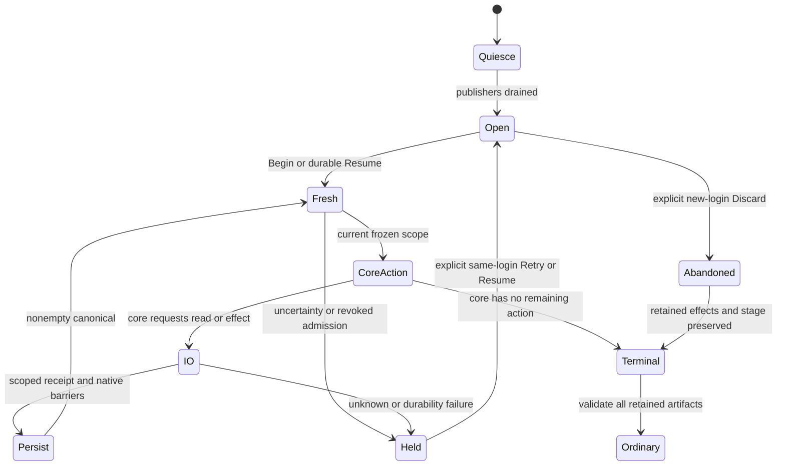

# Sync-chat carry JNI and storage

`PurpleSyncChatMoveCore.request(operation, input)` is a pure adapter to the
shared carry planner and journal. It does not read files, acquire account locks,
post messages, delete messages or schedule callbacks. The injected move executor
supplies verified transport and durability receipts. No production move backend
or user entry point is activated; those require later qualification.

The request is a UTF-8 JSON object carried in a byte array. The native strict
core JSON reader rejects duplicate keys, invalid UTF-8/Unicode, fractional and
unsafe JSON numbers, excessive depth and oversize input before decoding fields.
The complete request envelope is bounded to 4 MiB, including base64 expansion.
An oversized envelope refuses rather than truncating an inventory. Each binary
field is canonical padded base64: `state`, `journal`, `plan`, `bytes`,
`stagedRecord`, `retainedLocalText`, `preferenceToken` and prepared images.
A missing state is explicit JSON null, with a separate absence-confirmed flag.

The response has a named `status` and operation-specific fields. `canonical`
contains base64 of the exact core journal or prepared state bytes. `plan` and
`state` likewise contain the core codec's canonical bytes. These fields are
opaque persistence images. Never rebuild them from `JSONObject`, never patch
their known members in Java and never treat an empty canonical result as
permission to advance. A journal response also exposes named `phase`,
`nextAction` and decimal-string `revision` when its canonical bytes are nonempty.
Wait, Retry, NeedsReview and Superseded can have nonempty canonical journals;
the caller must durably retain them just as it retains Valid results.

Input protocol counters, message ids, dates and request identities are canonical
unsigned decimal strings, with no signs or leading zeroes. Dates and ids are
range checked before entering their signed core types. Selected-record projections and core journal/plan/state
images retain the core's existing safe-integer limits. Full-width 64-bit request
identities stay strings and are never converted through floating point.

Accounts use canonical environment/account keys, and peers use canonical typed
core tokens. A self-user alias refuses. Every operation consuming a journal or
plan requires independent `account`, `source` and `target` fields matching that
image. Events additionally retain the operation id and exact revision supplied
by `event`. An event for an earlier revision or another account/chat refuses.
Inventory messages must match their enclosing account and typed chat. Their
hashes are recomputed from exact bytes by MakeSyncCarryMessage, never trusted
from a Java-supplied hash. Ownership and completeness remain explicit facts.

## API map

- `hash`, `message`, `select`: SyncCarryRecordHash, MakeSyncCarryMessage and
  SelectSyncCarryHeads. Selection exposes records, heads, hashes, playlists and
  stamp through the core plan codec's selected-record representation.
- `plan`, `parsePlan`: PlanCarry, ParseSyncCarryPlan, SyncCarryPlanJson and
  SyncCarryPlanStamp. Inputs include scope, mode, access, eligibility, accepted
  reader consent, state/token, both inventories, optional exact ownVersion and
  winner, cleanup policy/authorization and playlist use. ownVersion carries
  text, key, parents, lineage, platform, app and at.
- `verify`, `prepareStage`, `usesState`, `prepareCommit`: the matching
  VerifySyncCarryReadback, PrepareSyncCarryStage, SyncCarryPlanUsesState and
  PrepareSyncCarryCommit functions. Verification includes missing hashes and
  destinationStamp; commit includes the exact canonical image and stateHash.
- `cleanupCandidates`, `sourceMatchesCleanup`: the matching shared cleanup
  calculators. These are planning answers, not a transport deletion capability.
- `finishPending`, `abandonPending`: FinishPendingStageForCarry and
  AbandonStageForLostChat. Results include status, beforeHash, stageHash,
  stageSeq and a prepared state image only when the core accepts it.
- `begin`, `parse`, `serialize`, `next`, `event`, `advance`, `resume`:
  Begin/Parse/SerializeSyncCarryJournal, NextSyncCarryJournalAction,
  SyncCarryEvent, AdvanceSyncCarryJournal and ResumeSyncCarryJournal.
  `begin` carries the captured scope, operation, mode, state/absence/token,
  resolution, eligibility/consent, explicit confirmation and immutable request
  ids/mark text. Resume's stateDurableConfirmed defaults to false.
- `commands`: SyncCarryJournalForwards and SyncCarryJournalPostsOwnRecord.
  Capture the returned commands before advancing a delivery intent.
- `checkDeletion`, `checkOldMarkDeletion`: CheckSyncCarryDeletion and
  CheckSyncCarryOldMarkDeletion, returning the exact `allowed` verdict. Both
  require a fresh complete destination and optional playlist receipt. The first
  takes a fresh message, the second a fresh old-mark receipt. Neither grants
  arbitrary stale-mark or whole-channel deletion.

Events use the core names PendingPrepared, StateObserved, StageRetired,
Resolution, PlanPrepared, OwnStagePersisted, DeliveryPrepared, DeliveryResult,
DestinationRead, MarkPostPrepared, MarkPostResult, MarkRead, CachePrepared,
CacheCompleted, CleanupCompleted and Cancel. Their optional payload names follow
the core fields: state/absence, stagedRecord, retainedLocalText, oldRead,
pendingReadback, preparedImageHash, resolution, plan, destination, playlist,
mark, cache, retiredStageHash, deleted, noRequestInFlight and noPendingFiles.
ObjectsDurable defaults to false. Omitted observations never become affirmative
ownership, completeness, durability or transport success.

Caches use chat/id/date. Marks add outcome, account, text, hasMedia and ownership.
Messages use account/chat/id/date/bytes/ownership/family. Inventories use
account/chat/complete/messages. Eligibility includes refusal and readers;
readers must state populationUnknown, with optional otherMembers/otherAdmins
counts. Playlist receipts carry status, scope, planStamp and destinationStamp.
Cache receipts carry operation, account, mark and complete. Enum names match
the shared headers exactly. Invalid transport encoding returns Invalid with no
canonical image. Newer journal formats return NewerVersion with no fallback.

## Retained bases and boundaries

The bridge preserves unknown core journal, plan and state members through their
core codecs. This includes the client-neutral `retained_config_bases` v1 object:
version 1, records containing sha256 and the complete canonical UTF-8 record as
a JSON string. The hash covers unescaped UTF-8 record bytes. The storage adapter below
enforces 256 KiB per record, sixteen distinct hashes, 2 MiB total raw records
and the 4 MiB encoded-state limit, preserve unknown container/entry members and
require an exact version key and lineage. The pure bridge preserves the container; the storage adapter validates and pins it.

The Android base pins the shared core through its gitlink. No shared algorithms,
new core lifecycle transitions or retention policy are copied into JNI. The
pending/protected-source, reader-baseline, interrupted abandonment, repair and
cleanup contracts are consumed from the pinned core. JNI projects those APIs;
it supplies no client fallback or replacement algorithm.

The real JNI host driver is described in
`TMessagesProj/jni/purple_jni/tests/sync_chat_move/README.md`. Host results do not
qualify Android directory durability, Telegram routes, shrinker behavior or UI.

## Durable operation storage

Android has worker-owned storage and an injected Carry executor. The production Change entry is qualification-held. They add no
live move transport or live backend. Existing user-facing Follow/Fill remain held.
The adapter delegates journal parsing, transitions, prepared images and hashes
to the shared core through the existing carry JNI surface.

`PurpleSyncChatMoveStore` owns the same account FileChannel lock as ordinary
settings sync. Its carry-only opening path runs before ordinary recovery,
changed-chat checks and stage cleanup. Any carry artifact, including a malformed,
newer or foreign journal or an orphan object directory, blocks ordinary writers
aacross close and restart until the terminal wrapper and every retained artifact
validate. Relink, Start again and interrupted ordinary recovery stay conservative
when carry artifacts remain. A new login cannot resume an old login's operation. Account removal
continues to own removal of account-local files; this adapter deletes no journal.

The account sync directory contains a bounded `carry.json` v1 envelope. It binds
account, preference-token SHA256, persistent login authority, operation identity,
canonical core journal and its SHA256, object hash-to-kind mapping, and optional
stable send identities. Unknown envelope and journal members survive writes.
Every nonempty canonical core reply is persisted, including Wait, Retry,
NeedsReview and Superseded. An empty reply grants no new storage action.

Immutable `carry-objects/{kind}-{sha256}.json` images precede journal references.
Kinds are state, record and text. State and journal limits are 4 MiB; record/text
limits are 256 KiB; objects are capped at 1,024 and 64 MiB total. At most 4,096
request keys map to unique nonzero signed 64-bit decimal send IDs. Mapping bytes
are committed before an ID is returned for an outward effect. The executor must
reuse the exact operation/request key and may not invent a new ID after restart.

New file operations run on a worker. Descriptor walks reject symlinks, regular
files require current uid, mode 0600 and one link, and immediate directories
require current uid and mode 0700. Snapshots retain parent/file identity, revision
and exact bytes. Writes create an exclusive private temporary, fsync it, recheck
parent and expected target, rename, fsync the renamed file and parent directory,
and reread. Failed barriers remain failures even when new bytes are visible.
Reopen re-establishes barriers before reporting durable state or absence. The
account lock provides cooperative serialization; this is not protection against
a hostile process replacing files outside that lock. Physical Android filesystem
and power-loss behavior still require later native qualification.

Prepared pending, reserved-own and committed state images remain exact core
bytes. They are not decorated after hashing. Only the current core action admits
a state write or exact stage retirement. The cache witness reads a valid matching
account/login/operation/target-mark cache and barriers it; it never changes reader
consent or warning sets. Unknown paths and malformed referenced images hold.

### Exact retained settings bases

The client-owned `retained_config_bases` v1 state member matches Desktop's format:
a version and an array of objects containing SHA256 and exact canonical record
UTF-8. Unknown fields survive. Bounds are 16 records, 256 KiB per record, 2 MiB raw
total and the existing 4 MiB state limit. Matching requires the exact version key,
lineage and space. A matching text fingerprint alone is not a version identity.

Ordinary confirmation embeds the verified staged record before retiring its stage.
Ordinary startup also pins and barriers the exact current base before deleting
an already-confirmed legacy stage or an unreserved stage. Invalid or newer
retention, missing base proof and a main-thread refusal preserve the stage and
state for worker recovery. A startup cleanup cannot erase its only exact base.
Apply/publish preflight pins the exact prior base to immutable private
`retained-bases/{sha256}.json` files before settings replacement or a new send.
Adoption adds the exact verified chosen record to the same inherited state commit.
Automatic plans include retention in their complete expected-state checkpoint
before execution. A legacy caller can supply verified exact inventory records.
If the old or new base cannot be proven, `MissingLocalVersion` holds the ordinary
operation; dirty local text is never labelled with an old identity. Automatic
planning holds for review when retention cannot be prepared.

`checkpointRetainedBases()` runs on worker-side ordinary open and requires an
idle store:
no pending stage or active/unfinished automatic checkpoint. It materializes and barriers
all embedded records before compacting ordinary embedded history to the current
base. Entries with unknown metadata remain embedded. Sidecars are bounded at
1,024 files and 64 MiB; recovery snapshots include them. Nothing is garbage
collected. Existing inherited state writes may embed retention; new directory
barriers and sidecar reads are not moved onto the GUI thread. A GUI caller that
needs sidecar validation is refused rather than doing new worker-only IO there.

### Host evidence

The `sync-chat-move-store` host-suite entry depends on real AGP classes, freshly
built host JNI, shared carry fixtures and the existing modern-sync platform ports.
It exercises actual temporary private files, CAS, rename/barrier failures, absence,
links/permissions/bounds, stable send IDs, reopen/login and ordinary-writer fences,
and exact retained base admission. Android platform/routing/Looper are explicit
host ports. Run it through the canonical host runner described in
[AGENTS.md](../AGENTS.md); the author runs the full set again on the delivered base.
The lock file is validated by metadata without opening a second descriptor.
Closing another descriptor for that inode would release POSIX process locks.
The owner also compares its open lock descriptor with the named inode.

The store is confined to its opening worker thread; lock order is the store
instance followed by the account-store instance and its short `OWNED_ROOTS` set
monitor. No supplier or component callback runs under that global monitor. The
host test runs a two-thread contender with a deadline and deadlock detection,
and an independent JVM verifies the kernel FileChannel exclusion. Retained file
operations reject the Android main Looper. The inherited single-state AtomicFile
writes remain at `PurpleAccountSyncStore.initialize`, `stageConfig`,
`confirmConfigReadBack` and `commitConfigState`; retention adds canonical bytes
to those writes. No new main-thread sidecar read or durability barrier is allowed.

This establishes host behavior, not phone lifecycle, power-loss or Telegram safety.

## Typed carry I/O and transport authority

Worker-owned `PurpleSyncChatMoveIO` and pure `PurpleSyncChatMoveRequests`
supply typed authority to the injected executor. No UI action, live request
caller or cleanup activation is supplied. Ordinary publishing still requires its existing
state, binding, consent and queue admission. Automatic sync stays Self-only.

A typed reader seals each downloaded record against a second exact native
messages response. The receipt owns serialized TL bytes and the exact record
body, captured account/RAM login, typed chat, message id, positive server date,
document id and edit date. Sealing checks C0 ownership, exact peer/id, document
constructor, declared size, filename/caption and response flags/counts. Invalid,
changed, inaccessible and incomplete evidence remains unknown. Newer-major
records accepted by shared core retain their original bytes.

Carry inventory conversion requires the actual scanner's complete receipt and
one sealed record per candidate id. The scanner captures the route and a
monotonic read sequence before reading its first page. A hand-built complete
inventory cannot prove absence. Conversion delegates message construction and
head selection to shared core, without reimplementing its version rules.

Forward requests retain captured source and target InputPeers, set silent and
drop_author, and keep media captions. Channel exact reads/deletes use their
channel constructors; ordinary peers use ordinary constructors, including when
the numeric ids coincide. Deletes contain one exact positive message id and
never whole-history deletion. `cleanupEnabled()` stays false. A pure request
builder confers no deletion authority.

### Reservation and permits

The reviewed core M2B5b gitlink is required for v2 delivery intents and the
reader baseline fixed before the first outward write. Android keeps the full
256-bit persistent login hash in its private envelope. Core v2's 32-hex login
token is the first 128 bits of that hash; its current-login argument uses the
same mapping. The RAM route UUID remains separate. No login value is logged.
Existing v1 journals remain readable but cannot issue carry permits.

Before an intent can issue effects, reserve every required forward random id,
core own/mark random id mapping and own upload file id. The reservation is a
single durable checked write. Canonical nonzero unsigned 64-bit decimal ids
retain all bits, remain distinct and survive retries/restart. No permit is
returned if the envelope cannot accommodate every future positive ack id.

Only a durable core DeliveryPrepared or MarkPostPrepared permits admission.
The private permit constructor seals operation, revision, O/N, payload hash,
request/file ids, account/login, current store epoch and fresh typed peers.
Fresh admission recomputes resolution and checks the expected winner/cache,
readability, eligibility and readers. Protected O can provide a retained own
version but cannot authorize forwarding. New known readers keep the accepted
baseline and a sticky warning; unknown readers or lost rights hold.

A carry permit can target N before ordinary settings state names N. Its frozen
own body comes from the journal plan; ordinary callers cannot replace it.
The upload port renews asynchronously through the worker before send and
requires a strictly newer permit with the same opening epoch, journal revision
and effect identity. Duplicate,
opening or stale renewal callbacks cannot dispatch. The common request
controller owns retry/flood scheduling. Combined waits use the latest active
deadline and monotonic scheduling.

Store transitions, failure or close replace a RAM epoch and revoke all old
permits. Shared worker-owned slot ownership prevents two wrappers from issuing
or reconciling one live effect. Closing an older wrapper releases only its
exact tokens. GUI capability checks inspect RAM and sealed bytes only. File,
JSON, hashing and store work stays on the worker; future callers must provide
an observer-free, lock-free RAM current predicate and queue store closure onto that worker. Transport/upload helpers borrow permits; the worker owner retains them through outcome recording and closes the I/O adapter on every terminal or cancellation path.

### Unknown outcomes and absence

Acknowledgements are hints. Strict Updates receipts match request random id,
positive server id, typed peer and C0 ownership. Short replies are accepted
only on non-channel paths. Captured-account Updates processing remains valid
after local cancellation; stale callbacks cannot confirm or dispatch new work.
Exact metadata/bytes/metadata and a complete N inventory still establish the
record evidence used by core.

D8 absence rules:

- Prepared, never-issued slots can receive their first permit after durable
  intent and fresh admission.
- Issued or unknown record slots, including after restart, hold until a new
  complete scoped destination scan begun after a worker read ticket finishes.
  An exact matching record hash verifies the slot. Complete absence permits
  retry with the same persisted ids. Incomplete, older, wrong-scope, corrupt or
  substituted evidence holds.
- An active slot cannot be reconciled. Each durable transport write replaces
  nonrepeating RAM slot-generation tokens shared by every wrapper on that store.
  Tickets bind the token as well as the opening epoch and scanner sequence, so an
  overlapping ticket cannot reuse absence across an unknown/prepared/unknown cycle.
  Reconciliation consumes its ticket once.
- A mark read requires the saved request-bound acknowledgement id, exact
  canonical text, positive date, typed target, C0 ownership and no media.
  Empty search, zero-row exact read, messageEmpty and unknown transport never
  prove that an issued mark was unsent. Without matched-request evidence it
  holds, including after restart.
- Changed winner and login do not erase issued effects or retarget them.
  Abandon/recovery decisions belong to shared core and the worker executor.

### Private transport extension

The bounded carry envelope adds `transport`, version1, and
`transport_sha256`. Absence of both means no reservation yet. The checksum
covers domain `purple-sync-carry-transport-v1`, account, binding hash, full
persistent login, operation, integer mode, O/N and the whole transport object.
It detects corruption/substitution and is not a secret-key MAC. Unknown fields
are preserved. Core journal/state hash meanings do not change.

`entries` is keyed by SHA256(kind + ':' + source_id + ':' + record_hash).
Each entry holds kind (forward/own/mark), hash, integer source_id, canonical
random_id/file_id strings and state (prepared/issued/unknown/verified). Only
forward has a positive source id; only own has a nonzero file id. Optional
ack_id is a positive request-bound hint. Readers retain accepted members,
count strings and warning, plus a sticky reader_warning. Malformed or newer
extensions, duplicate ids, mismatched scope and overflow refuse without
truncating the existing journal. The 4 MiB/1024-entry limits remain.

### Host and native qualification

The carry-I/O host driver loads actual AGP business classes and host JNI. It
uses real generated TL byte encoding/decoding with controlled Android platform,
file/download, request and timer ports. It exercises typed equal-number routes,
C0/final metadata, durable identities, restart/uncertain reconciliation,
reader/login fences, failure/capacity, cancellation, stale/duplicate callbacks
and late Updates. No live request is dispatched.

The full host suite and affected arm64 units qualify compilation and synthetic
contracts. They do not establish Telegram forwarding behavior, Android UI or
server acceptance, physical device durability, or production move execution.
Those require later separately authorized qualification.

## One worker Carry executor

`PurpleSyncChatMove` is package-private and created only through an injected
`PurpleSyncChat.move(Port)` seam. The port supplies worker scheduling, current
RAM login/foreground admission, fresh typed facts and controlled transports.
There is no production implementation of that port, screen, Telegram dispatch
or automatic activation. The service, manual runner and automatic engine expose
quiescence hooks without starting a move themselves.

Core `NextAction` is the only phase authority. Java retains a run, command ticket
and exact active command for callback ownership. Commands freeze account, RAM
origin, persistent login, operation, O/N and journal revision. Every reply checks
that identity; synchronous status observers are followed by admission checks.
Closing or losing foreground revokes permits immediately and queues resource
release on the worker. A late callback cannot clear a later command or revive a
closed owner. Failed cleanup still releases the exact account/file leases.

Before Begin, the account Carry lease blocks ordinary acquisition. Registered
publisher cancellation callbacks run outside the operations monitor. The service
drains a captured queue, including throwing/reentrant observers; the manual
runner and automatic engine suspend their own operation. Injected quiescence
must finish their queued worker cleanup before the executor opens the account
store. A still-owned publisher produces `PublishersNotQuiescent`. The account
file lock is retained through the move. GUI-facing permit predicates are
observer-free RAM checks; the store, JSON, hashing and barriers stay on the worker.

The action order is:

1. Open before ordinary stage cleanup, quiesce, and persist Begin plus exact
   opening stage/base objects. A resumed journal reopens and barriers durable
   objects, then obtains fresh complete resolution before progressing.
2. ResolvePending reads O. Readable exact landed bytes finish the pending state;
   an unlanded readable record uses its frozen O upload permit and stable ids,
   then rereads. Protected O never receives a send. Imported uncertainty and any
   saved issued intent establish a durable Issued floor, so later NotIssued
   cannot replace the required complete scoped read. Definite ChatGone uses the
   core loss transition while retaining exact local bytes.
3. WritePendingState and RetirePendingStage persist the prepared image, barrier
   it, retire only exact old bytes and acknowledge through core. ResolveAgain
   and Plan use fresh sealed inventories and the exact retained own base.
4. StageOwn persists the immutable own record and reserved state. Delivery
   reservations precede DeliveryPrepared. Prepared slots issue once; uncertain
   slots require a new complete scan after their read ticket. Core missing-record
   Retry is persisted before another delivery intent. One slot dispatch per run
   prevents an automatic retry loop; explicit Retry can begin another run.
5. VerifyDestination prepares the exact N state and any deferred target stage
   through PrepareSyncCarryJournalCommit. Unknown or missing evidence cannot
   commit. A restart before DeliveryPrepared first reads N; it cannot send until
   core returns through Deliver and a durable intent.
6. Switch and RepairMark persist MarkPostPrepared before dispatch and require
   saved request-bound ack plus exact canonical owned mark readback. Follow and
   Fill read their frozen existing target mark by exact typed id/date, supported
   text, C0 ownership and no media; they never invent an own-request ack or post
   another mark. A changed resolver winner admits only frozen reconciliation if
   it is this operation's saved own ack or existing/verified target mark. New
   effect admission still checks the opening resolution.
7. PrepareCache writes a private incomplete cache. CommitState writes the exact
   retained image and pins its exact base for ordinary recovery. RetireOwnStage
   retires only exact obsolete bytes and installs/barriers the already-reserved
   deferred N stage. CompleteCache unions disclosures and preserves the accepted
   reader baseline and sticky warnings before ordinary admission.
8. Cleanup completes empty authorized work, or passes definite scoped R3
   ChatGone to core. Unknown, MarkGone, protection, contradictory scope and any
   remaining deletion policy hold. Explicit SkipCleanup is core-authorized;
   arbitrary record, mark and whole-chat deletion remain disabled.

Every nonempty core canonical reply is persisted before its status is used,
including holds and retries. An empty reply holds without progression. Resuming
missing, malformed, foreign-login or newer evidence does not fabricate state.
RepairMark preserves the exact ledger/binding. No-state Fill preserves state
absence; unreadable Fill source holds.

### Interrupted Discard and terminal evidence

A new login cannot Resume. Its explicit Discard validates under the retained
wrapper authority and calls AbandonInterruptedOperation with the current login.
It sends nothing and retains every reservation, ack and unresolved effect. Before
N state commit it preserves actual O state and stage. After commit it materializes
and barriers exact already-reserved target pending bytes before terminal
abandonment, whether the obsolete carry stage is still present or was already
retired. It cannot leave an ordinary pending sequence without its exact file.

Terminal carry.json remains durable. Ordinary worker opening validates its
codec, account/binding and terminal status; every carry-object name/hash and all
history wrappers are checked, including unreferenced objects. Objects are bounded
to 1,024/64 MiB, histories to 256/64 MiB, with existing per-image caps. A later
Begin first archives the complete terminal wrapper under its hash and barriers
it. Unknown paths, corrupt history, overflow or a failed barrier hold admission.
A terminal wrapper from an earlier login is an integrity record, so a new
operation can archive it without resuming its effects. No-state Fill retains
its empty binding scope after later ordinary state initialization. No
history/object garbage collection is added. Static relink/reset paths retain
their conservative carry-artifact guard.

### Playlist hook and evidence limits

Absent playlists permit NotInUse. State/library pending facts and observed O/N
playlist records force a hold before settings delivery. Raw Verified JSON is not
a playlist proof. The typed PlaylistReceipt hook has no issuer in this slice;
there is no Android playlist carry producer, so required playlists remain held.
A future issuer must supply genuinely verified scope/plan/destination evidence,
which is rechecked through core. No receipt is synthesized, and no playlist
merge, forwarding, pruning or fake complete inventory is implemented.

The registered `sync-chat-move-executor` host suite uses actual AGP business
classes, fresh host JNI, real private files and narrow synthetic Android/cloud
ports. It covers each action/reopen boundary, exact write/rename/barrier faults,
effect-before-ack, protected pending and own-base recovery, failed N/mark reads,
cache/state gaps, deferred Discard, late callbacks, throwing cancellation,
quiescence lock order, ordinary terminal admission and shared uploader claims.
The service fixture separately exercises its queued quiescence callback. The
canonical in-tree runner requires completion records and floors for these tests.
Affected arm64 compilation is separate from Android filesystem, phone lifecycle,
UI and Telegram-server qualification; none of those native behaviors is claimed.

### O-pending read chronology

A Pending command opens a read ticket after store reopen and after the current scanner sequence. Its sealed, complete O inventory must come from a scan started after that ticket, scoped to the exact account/source and pending bytes. A retained older scan cannot prove an issued pending record absent. The ticket belongs to the store epoch and shared pending-slot generation, and consuming it invalidates sibling tickets. Issuance, renewal and outcome consumption invalidate the shared generation too. A private absence proof admits one pending attempt; a found-record proof feeds one core transition. Renewals retain the same active request and upload claim.

Affirmative Issued observations are persisted before checking inventory or chronology, so invalid evidence cannot erase the conservative floor. A stale scan leaves ResolvePending, its exact stage and the floor intact. A new post-outcome O scan can reconcile the existing record without a duplicate send or deferred record. Definite scoped ChatGone retains its separate R3 path; it is never inferred from an empty inventory.

## Provision-only Change boundary

The injected Change controller revalidates captured source state/cache/winner and target/readers before it starts Carry. Carry opens under its account lease, checks exact state and cache bytes, and obtains fresh resolution before Begin. The foreground screen owner, origin/login and each async callback identity stay live through actual admission. Required playlists and old-message deletion policy retain their existing conservative holds.

Create uses the existing setup engine in a separate `MoveProvision` purpose, bound to the opening fingerprint. Its capped child file is `sync-chat-move-create.json`. A durable CreateStarted journal precedes dispatch. An uncertain creation reconciles the same operation after reopen, with a matched-operation proof; it never adopts by title or blindly creates again. ApplyUpdates precedes full info, a complete Empty inventory, and a second full-info check. Only then is Provisioned durable. Setup and MoveProvision journals refuse each other's purpose.

Provisioned proves a target, not a committed move. This mode cannot post a mark, commit ordinary cache, or pin/mute/archive. Reopening Provisioned revalidates rights/readers and inventory without entering ordinary setup's post-mark consent/cache path. Cancellation keeps the child journal and never deletes an orphan channel. The injected controller passes the proven channel into the existing Carry executor.

Only a private committed receipt from actual destination verification, mark readback, committed exact state and completed cache permits decoration. Only a newly created channel gets silent pin, mute and archive, in that order. Existing chats and Saved Messages never get these effects. A provisioning receipt, phase name or observer callback cannot forge that authority. Production supplies no transport adapter while activation is false.

Host suite `sync-chat-change` uses actual AGP business classes and controlled ports with real child/Carry files. It pins eligibility and reader consent, state/cache/winner changes, foreground revocation, defaults/disclosure, purpose separation, ambiguous creation restart, duplicate callbacks, orphan retention and committed-only decoration. It runs alongside the unchanged Pending chronology regressions. Device lifecycle, Telegram behavior and physical power-loss durability remain unqualified.

Decoration callbacks retain their step while waiting or held. An unsuccessful pin, mute or archive callback remains held across later Carry Cleanup/Done progress. Only an explicit retry of the held step can continue; successful earlier steps are preserved. Closing the flow revokes retries. Process-restart decoration reconciliation remains unqualified, so an uncertain decoration is never automatically repeated after a restart.
